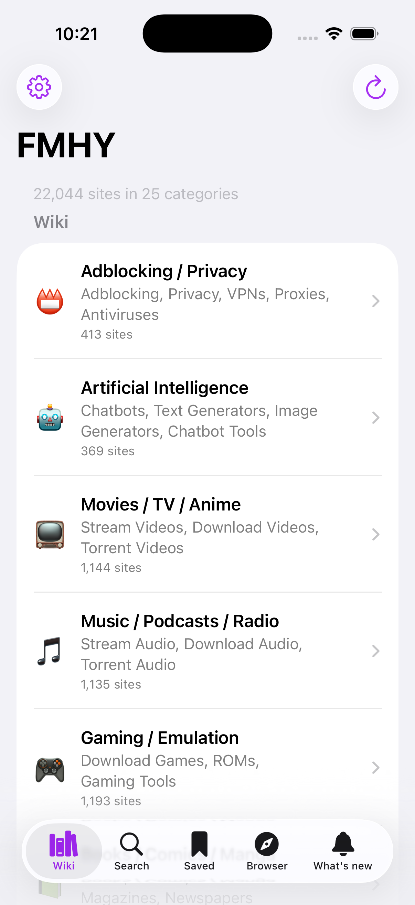
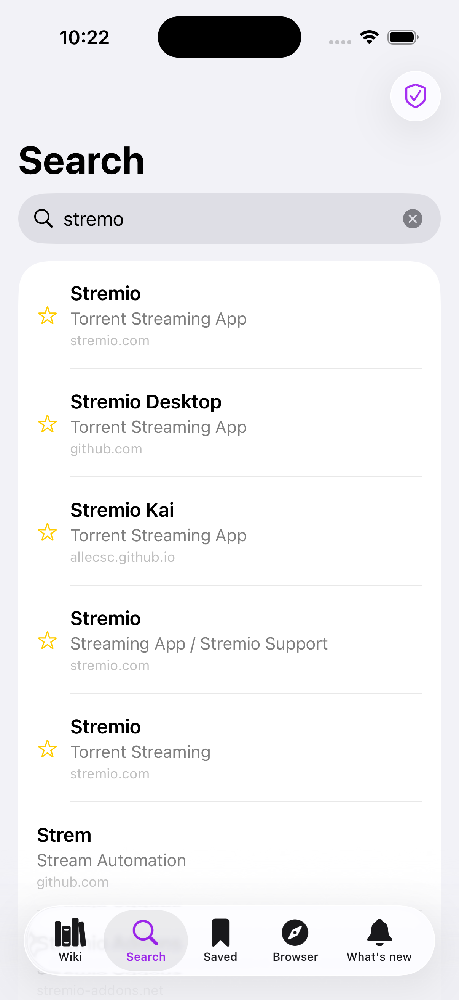
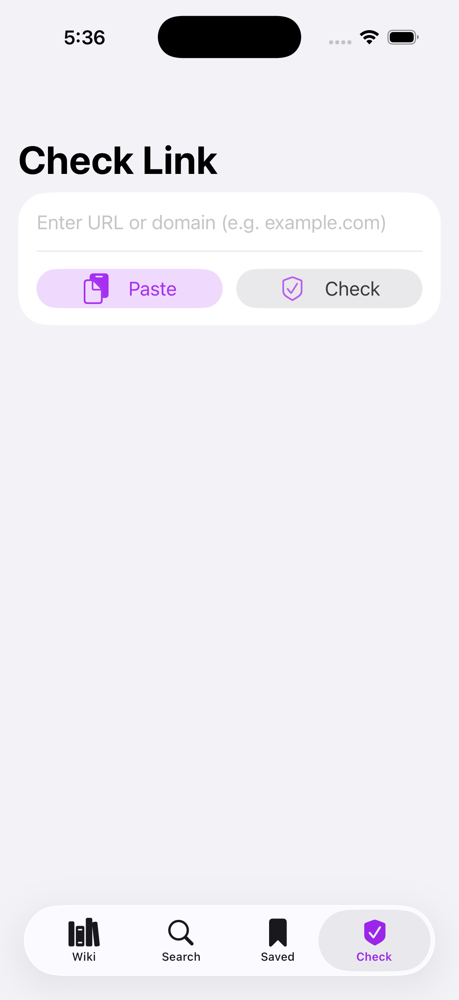
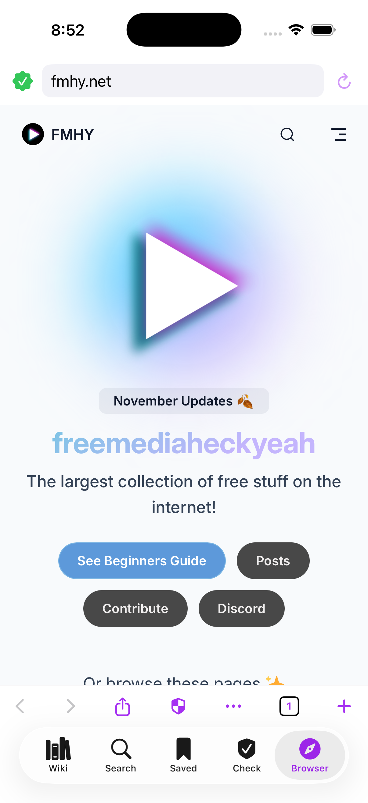
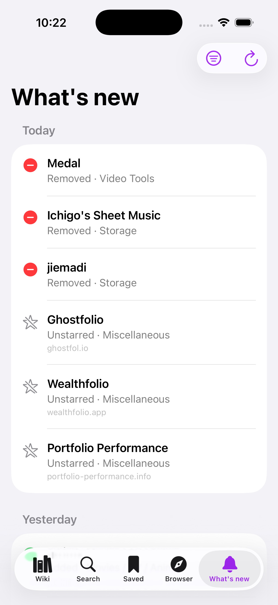

# FMHY for iOS

**The whole FMHY wiki on your iPhone: searchable, offline, with a link checker.**

iOS 17+ · Free & open source · No ads · No tracking · No accounts

[**⬇️ Download the latest .ipa**](https://github.com/spananide/fmhy-ios/releases/latest) · [🐞 Send feedback](https://github.com/spananide/fmhy-ios/issues/new/choose)

    

The official iOS port of [FMHY for Android](https://github.com/omeg4-dev/fmhy-android) by omeg4-dev. This is a community app: not an official FMHY project and not yet featured on fmhy.net.

## Features
- 📴 **Offline from the first launch.** The wiki is bundled; the refresh button pulls the latest from [fmhy/edit](https://github.com/fmhy/edit).
- ⚡ **Search** that forgives typos (`stremo` finds Stremio) and understands `in:video anime`, `is:starred`, `site:github.com` and `"exact phrase"`.
- 🌟 Stars and top picks, mirrors and extra links per site, base64-hidden links decoded for you.
- 🔖 **Saved:** swipe a site to bookmark it, share your list.
- 🛡️ **Check:** paste a link to see if it is on FMHY, starred, on the unsafe list, or a clone (uses the [FMHY SafeGuard](https://github.com/fmhy/FMHY-SafeGuard) lists).
- 🌐 **Built-in browser:** tabs, private tabs, address/search bar, desktop-site toggle, a badge that tells you if the current site is on FMHY, and a warning page before FMHY-listed unsafe sites.
- 🚫 **Ad blocking:** ~119,000 rules (EasyList, EasyPrivacy, Peter Lowe's list, FMHY filterlist), cookie-banner hiding and popup limiting, switchable per site.
- 📊 Site counts, in the same order and groups as fmhy.net (Wiki, Tools, More).
- 🔔 **What's new:** added, removed, starred and moved sites from the last 120 days (feed by omeg4-dev), "NEW" badges, and follow categories to get a notification when new sites arrive (iOS may delay background checks).
- ⬇️ **Downloads:** files from the browser land in the app's Downloads folder (visible in the Files app) with progress, pause/resume for link downloads, share/preview, a warning before opening risky files (.ipa, .exe, .apk, ...), and an optional VirusTotal hash check with your own free API key (only the file's hash is sent).
- ⚙️ **Settings:** light/dark/pure-black theme, accent colour, text size, search engine, open links in-app or Safari, ad-block allowlist, Wi-Fi-only refresh, backup and restore of bookmarks and follows.
- 🔒 No analytics, no servers of mine in between.

Not in the iOS version: home-screen widgets (free Apple ID signing makes extensions unreliable), Android-only features (Material You, shortcuts).

## Install (free, no Mac needed)
The app is not on the App Store, so you sideload the `.ipa` from [Releases](https://github.com/spananide/fmhy-ios/releases/latest).

**Option A: Sideloadly (Windows or Mac)**
1. Install [Sideloadly](https://sideloadly.io) (and iTunes on Windows, the Apple website version).
2. Plug in your iPhone, trust the computer.
3. Drag `FMHY-iOS-vX.Y.Z.ipa` into Sideloadly, enter your Apple ID, press **Start**.
4. On the iPhone: Settings → General → VPN & Device Management → trust your Apple ID.
5. On iOS 16+ also turn on Settings → Privacy & Security → **Developer Mode** and restart.

**Option B: [SideStore](https://sidestore.io) or [AltStore](https://altstore.io)** — add the `.ipa` from the Files app. SideStore refreshes by itself without a computer.

**Option C: Linux**
Sideloadly has no Linux version, use one of these instead:
1. Install the USB helpers: `sudo apt install usbmuxd libimobiledevice-utils` (Fedora: `sudo dnf install usbmuxd libimobiledevice-utils`, Arch: `sudo pacman -S usbmuxd libimobiledevice`), then plug in the iPhone and tap **Trust**.
2. Install [Sideloader](https://github.com/Dadoum/Sideloader) (native Linux app) or [iloader](https://github.com/nab138/iloader), sign in with your Apple ID and pick `FMHY-iOS-vX.Y.Z.ipa`.
3. On the iPhone: Settings → General → VPN & Device Management → trust your Apple ID, and turn on **Developer Mode** (Settings → Privacy & Security), then restart.
4. Tip: iloader can also install [SideStore](https://sidestore.io), which then refreshes the app every week by itself without the PC.

A free Apple ID signs apps for **7 days**: reopen Sideloadly (or SideStore) once a week to refresh. Free accounts can have 3 sideloaded apps at once. Your bookmarks survive a refresh.

## Feedback & bugs
Open an [issue](https://github.com/spananide/fmhy-ios/issues/new/choose) (or use "Send feedback" at the bottom of the Wiki tab). Site suggestions belong to the FMHY team: [fmhy.net/other/contributing](https://fmhy.net/other/contributing).

## Build it yourself
No Mac needed: GitHub Actions (`.github/workflows/build.yml`) fetches the wiki (`tools/fetch-data.sh`), runs the tests, takes screenshots and builds the unsigned `.ipa`. Fork the repo, push a tag like `v1.0.1`, and the release appears. Locally on a Mac: `bash tools/fetch-data.sh && xcodegen generate`.

## Credits & license
GPL-3.0-or-later, derived from [omeg4-dev/fmhy-android](https://github.com/omeg4-dev/fmhy-android) (parser, search and link-check logic ported to Swift). Wiki content by the [FMHY](https://fmhy.net) team; link lists from [FMHYFilterlist](https://github.com/fmhy/FMHYFilterlist) and [FMHY-SafeGuard](https://github.com/fmhy/FMHY-SafeGuard).

Built with the help of AI coding assistants; I design the features and review the result. If you spot a bug, please open an issue.
